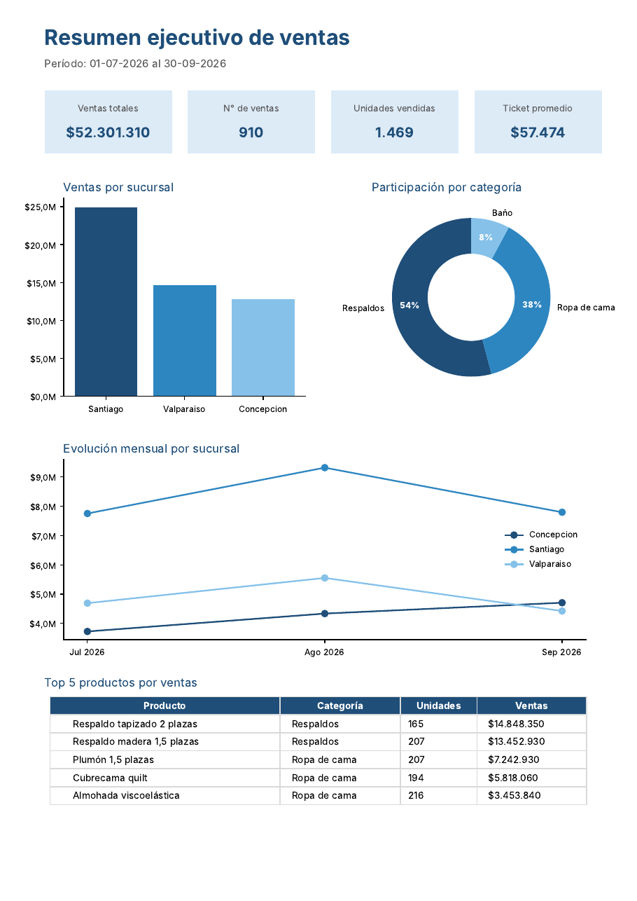

# 📊 Automatizador de reportes de ventas

Herramienta en Python que **toma archivos de ventas desordenados (CSV y Excel), los limpia, los consolida y genera automáticamente un reporte en Excel y un resumen ejecutivo en PDF**, que además puede enviar por correo de forma programada.



---

## El problema

Una distribuidora con 3 sucursales recibe cada mes las ventas de cada una **en un formato distinto**:

| Sucursal | Formato | Problemas |
|---|---|---|
| Santiago | CSV separado por `;` | Montos como texto (`$12.990`), fechas `dd/mm/aaaa` |
| Valparaíso | Excel | Columnas con otros nombres (`Item`, `Unidades`, `Ejecutivo`), productos en mayúsculas y con espacios |
| Concepción | CSV separado por `,` | Columnas en MAYÚSCULAS, filas duplicadas, filas vacías, ventas sin cantidad |

Consolidar esto a mano en Excel toma **varias horas al mes** y es propenso a errores.

## La solución

```
data/entrada/*.csv, *.xlsx  ──►  limpieza y normalización  ──►  reporte_ventas.xlsx
                                  (registro de correcciones)     resumen_ventas.pdf
                                                                 ──► envío por correo
```

Un solo comando realiza todo el proceso en **segundos**:

1. **Detecta automáticamente** el separador de cada CSV y reconoce columnas con distintos nombres (`Item` = `Producto`, `Ejecutivo` = `Vendedor`, etc.).
2. **Limpia**: convierte montos y fechas en cualquier formato, normaliza textos, elimina filas vacías, duplicadas e inválidas.
3. **Deja trazabilidad**: una hoja "Calidad de datos" muestra qué se corrigió en cada archivo.
4. **Genera un Excel** con 6 hojas: Resumen con KPIs y gráficos, evolución mensual, ranking de productos, desempeño de vendedores, detalle consolidado (con filtros) y calidad de datos.
5. **Genera un PDF** de una página listo para gerencia.
6. **Envía** el reporte por correo (opcional) y puede **programarse** para que corra solo cada mes.

## Resultado con los datos de ejemplo

| Archivo | Filas leídas | Filas válidas | Correcciones |
|---|---|---|---|
| ventas_concepcion.csv | 251 | 230 | 5 vacías, 4 inválidas, 12 duplicadas |
| ventas_santiago.csv | 420 | 420 | Montos y fechas convertidos |
| ventas_valparaiso.xlsx | 260 | 260 | 25 nombres de producto normalizados |

## Tecnologías

Python 3.10+ · pandas · openpyxl (gráficos nativos de Excel) · matplotlib · smtplib · pytest

## Cómo usarlo

```bash
# 1. Instalar el proyecto (desde la carpeta del proyecto, una sola vez)
pip install -e .

# 2. (Opcional) generar los datos de ejemplo
python scripts/generar_datos_ejemplo.py

# 3. Generar el reporte (Excel + PDF)
python -m reportero --pdf

# Con otras carpetas
python -m reportero --entrada C:\ventas\octubre --salida C:\reportes --pdf

# Enviar por correo (configurar antes el archivo .env a partir de .env.ejemplo)
python -m reportero --pdf --enviar gerencia@empresa.cl
```

Los reportes quedan en la carpeta `salida/`.

### Programarlo para que corra solo

- **Windows:** Programador de tareas → Crear tarea básica → Acción: `python -m reportero --pdf --enviar ...` con "Iniciar en" la carpeta del proyecto.
- **Linux / Mac (cron):** `0 8 1 * * cd /ruta/proyecto && PYTHONPATH=src python3 -m reportero --pdf --enviar gerencia@empresa.cl`

### Adaptarlo a otro negocio

Para aceptar un nuevo formato de archivo basta con agregar el nombre de la columna en el diccionario `SINONIMOS` de [`src/reportero/limpieza.py`](src/reportero/limpieza.py).

## Estructura

```
├── data/entrada/            # archivos de ejemplo (ficticios)
├── docs/                    # capturas para este README
├── scripts/
│   └── generar_datos_ejemplo.py
├── src/reportero/
│   ├── __main__.py          # línea de comandos
│   ├── limpieza.py          # lectura, normalización y control de calidad
│   ├── reporte_excel.py     # Excel con KPIs, tablas y gráficos
│   ├── reporte_pdf.py       # resumen ejecutivo en PDF
│   └── correo.py            # envío por SMTP
└── tests/                   # pruebas automatizadas (pytest)
```

## Pruebas

```bash
pip install pytest
python -m pytest
```

---

> Todos los datos de este repositorio son **ficticios** y fueron generados con `scripts/generar_datos_ejemplo.py`.

**¿Necesitas automatizar reportes en tu empresa?** Contáctame: clayer2001@gmail.com 
